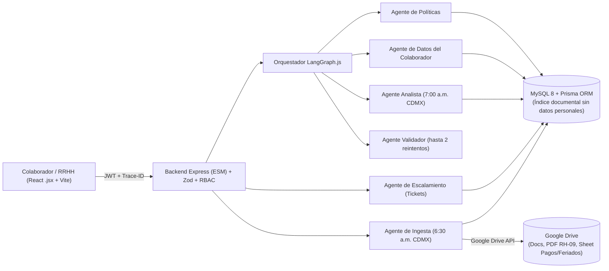

# Arquitectura, Búsqueda Documental y Definiciones — Nubera Digital

## 1. Diagrama de Arquitectura

## 2. Documentos, Chunking y Embeddings

- **Documentos indexados:** 11 activos oficiales reales en Google Drive (`RH-01` a `RH-10` y calendario `RH-11`/`RH-12` en dos pestañas de cálculo) con metadatos completos (`drive_file_id`, `policy_code`, `title`, `section`, `version`, `effective_date`, `owner`, `drive_url`).
- **Estrategia de fragmentación:** Segmentación por secciones y filas de tabla sin dividir palabras a la mitad (`maxChars = 850`), conservando encabezados de tabla y todas las pestañas de hojas de cálculo.
- **Embeddings:** Vector normalizado de **384 dimensiones** (`EMBEDDING_DIM=384`) en JavaScript puro (`crypto` + tokens normalizados en español, sinónimos de RRHH, bigramas y 4-gramas).
- **Umbral de recuperación:** `MIN_RELEVANCE_SCORE = 0.28` + verificación léxica de respaldo. Consultas sin evidencia disparan sugerencia de ticket con RRHH.
- **Seguridad documental:** Sanitización de instrucciones maliciosas durante la ingesta y alerta persistente `inyeccion_detectada` en `document_audit_alerts`.

## 3. Fórmulas del Reporte Diario y Concurrencia

- **Ausencias de hoy:** Personas únicas (`DISTINCT employee_id`) con solicitudes aprobadas de tipo `vacaciones`, `permiso_con_goce`, `permiso_sin_goce` o `incapacidad` (excluye `home_office`).
- **Solicitudes pendientes > 3 días:** Solicitudes con `status = 'pendiente'` cuya fecha de creación en `America/Mexico_City` supera los 3 días respecto al corte.
- **Criterios de saldo vacacional:** Las solicitudes pendientes reservan saldo; la aprobación bloquea la fila con `SELECT ... FOR UPDATE` para impedir descuentos dobles en operaciones concurrentes.
- **Idempotencia:** `generateDailyReport` ejecuta `prisma.dailyReport.upsert` sobre `reportDate`.
