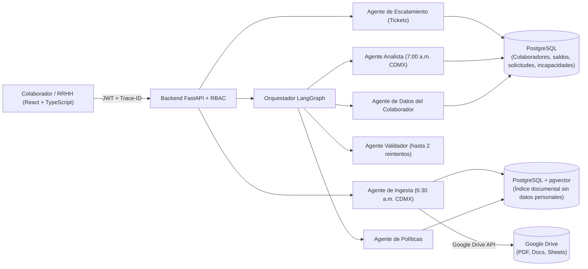

# Arquitectura, Búsqueda Documental y Definiciones — Nubera Digital

## 1. Diagrama de Arquitectura

## 2. Documentos, Chunking y Embeddings

- **Documentos indexados:** 10 políticas internas (`RH-01` a `RH-10`) con metadatos completos (`drive_file_id`, `policy_code`, `title`, `section`, `version`, `effective_date`, `owner`, `drive_url`).
- **Estrategia de fragmentación:** Segmentación estructural por sección lógica (tamaño objetivo: 400–900 caracteres por fragmento; solapamiento contextual mediante encabezado de título + sección en cada vector).
- **Embeddings:** Vector de **384 dimensiones** (`EMBEDDING_DIM=384`) configurable por variables de entorno (`LLM_PROVIDER`, `OPENAI_API_KEY`, `GEMINI_API_KEY`). En modo local determinista combina tokens normalizados en español, expansión de sinónimos de RRHH, bigramas y trigramas de caracteres.
- **Umbral de recuperación:** `MIN_RELEVANCE_SCORE = 0.28` + verificación léxica de respaldo (`has_lexical_grounding`). Valores inferiores disparan la respuesta de evidencia insuficiente y ofrecen crear un ticket.
- **Seguridad documental:** Las instrucciones incrustadas dentro de documentos se sanitizan durante la ingesta (`_sanitize_document_text`) y se registran como alertas `inyeccion_detectada` en `document_audit_alerts`.

## 3. Fórmulas del Reporte Diario y Tratamiento de Ausencias Multidía

- **Ausencias de hoy:** Conteo de solicitudes con `status = 'aprobada'` donde `start_date <= report_date <= end_date`. Una ausencia que abarca varios días se contabiliza una vez en cada día calendario dentro del intervalo `[start_date, end_date]`.
- **Solicitudes pendientes > 3 días:** Solicitudes con `status = 'pendiente'` donde `(report_date - created_at::date) > 3`.
- **Tasa de rotación mensual (%):** `(salidas_del_mes / plantilla_activa) * 100`.
- **Porcentaje resuelto sin escalar (%):** `(consultas_con_outcome_resuelta / total_consultas) * 100`.
- **Idempotencia:** `generate_daily_report(db, target_date)` realiza `UPSERT` lógico sobre `daily_reports.report_date`, permitiendo reintentos sin duplicar registros.

## 4. Funcionalidades Verificadas y Limitaciones Conocidas

- **Verificadas:** Autenticación JWT y RBAC en servidor, 7 agentes con LangGraph y prompts versionados en `prompts/`, 10 políticas con citas completas, aislamiento de datos personales, detección de versiones contradictorias e inyecciones, flujo de tickets con confirmación, dashboard diario con selector de fechas y exportación JSON/CSV.
- **Limitaciones conocidas:** En el entorno local sin Docker/PostgreSQL ni credenciales OAuth de Google Cloud, el sistema opera con SQLite + similitud coseno en memoria y catálogo local de políticas; al configurar `DATABASE_URL` hacia PostgreSQL con `pgvector` y `GOOGLE_DRIVE_ENABLED=true`, activa la infraestructura productiva sin cambios de código.
