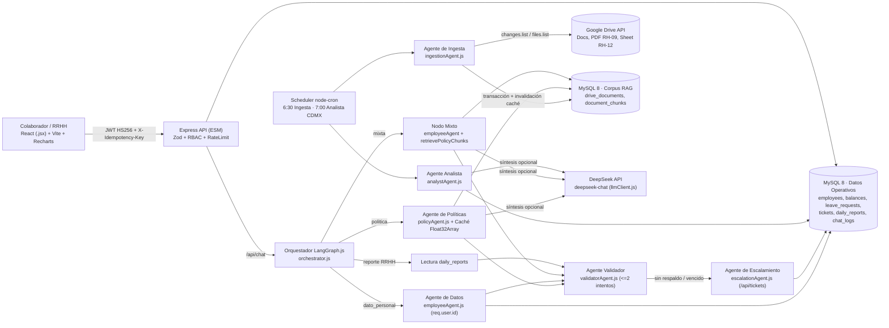

# Informe Técnico — Portal de Consulta de Políticas de RRHH con RAG Multiagente (Nubera Digital)

**Proyecto:** Mini Proyecto #2 · Portal interno de Recursos Humanos con RAG multiagente  
**Repositorio:** `https://github.com/danielramirez272006-arch/nubera-digital`  
**Commit documentado:** `4e87182` (`main`) · **Fecha:** 19 de noviembre de 2026  
**Stack implementado:** JavaScript (ES Modules) · Node.js v24 · Express · Prisma ORM · MySQL 8 · LangGraph.js · React + Vite + Recharts · Google Drive API · DeepSeek (`deepseek-chat`)

---

## 1. Objetivo, alcance y clasificación de requisitos

### 1.1 Contexto y propósito
**Nubera Digital** es una empresa ficticia de servicios tecnológicos ubicada en Ciudad de México con **50 colaboradores simulados** y 3 meses de movimientos históricos. El portal resuelve dos problemas operativos del área de Recursos Humanos: (1) responder en lenguaje natural las consultas frecuentes de los colaboradores con base exclusiva en políticas oficiales alojadas en Google Drive y registros personales propios, sin alucinaciones ni fugas de información de terceros; y (2) automatizar el reporte ejecutivo diario de RRHH a partir de consultas SQL deterministas sobre la base de datos relacional.

### 1.2 Distinción entre requisitos obligatorios, sugerencias y puntos extra del enunciado

| Categoría del enunciado | Requisito | Estado en la implementación actual |
|---|---|---|
| **Obligatorio** | 10+ políticas en Drive en 3 formatos (Google Docs, PDF, Sheets) con título, versión, vigencia y responsable | **Implementado:** 11 documentos activos (`RH-01`–`RH-10` + `RH-12` Google Sheet con 2 pestañas; `RH-09` en PDF). |
| **Obligatorio** | 5 agentes base (Orquestador, Políticas RAG, Datos del colaborador, Analista, Ingesta) | **Implementado** en `backend/src/agents/`. |
| **Obligatorio** | Separación estricta entre corpus documental y datos personales + RBAC (`colaborador` / `rrhh`) | **Implementado** (`drive_documents`/`document_chunks` separados de tablas operativas; `requireAuth` + `requireHrRole`). |
| **Obligatorio** | Reporte diario automático (7:00 a. m.) con los 8 elementos mínimos e historial + dashboard con >=4 KPIs y >=2 gráficos | **Implementado** (`analystAgent.js`, `scheduler.js`, `DashboardPage.jsx`, `ReportesPage.jsx`). |
| **Obligatorio** | Banco de 45 preguntas (25 originales + 20 propias), >=80 % aciertos, >=90 % <8 s y 0 fugas en #21/#22 | **Evaluado:** `40/45` (`88.9 %`) con DeepSeek real, `100 % < 8 s` (`p90 = 3203 ms`), `0` datos filtrados (`#22` presenta defecto de clasificación documentado en §12). |
| **Sugerencia (alternativa válida)** | Stack sugerido: Python/FastAPI + PostgreSQL/pgvector + Gemini/Claude | **Alternativa elegida y justificada (§3):** Node.js/Express + Prisma/MySQL 8 + búsqueda vectorial en memoria (`Float32Array`) + DeepSeek (`deepseek-chat`) + OAuth 2.0 / Service Account en Drive. |
| **Puntos extra** | Agente Validador (`validatorAgent.js`) y Agente de Escalamiento con tickets (`escalationAgent.js`) | **Implementado:** ambos agentes operativos e integrados en el grafo y en `/api/tickets`. |

---

## 2. Arquitectura real y separación de almacenes

El sistema opera sobre **dos caminos independientes** (flujo conversacional en tiempo real y flujo programado de ingesta/reporte) y mantiene una **separación estricta de responsabilidades y datos** dentro de MySQL 8:

1. **Almacén documental (corpus RAG sin datos personales):** tablas `drive_documents`, `document_chunks` y `document_audit_alerts`. Únicamente el **Agente de Ingesta** escribe en estas tablas y únicamente el **Agente de Políticas** (o el nodo mixto del Orquestador) las consulta para recuperación semántica.
2. **Almacén operativo (datos estructurados por usuario y reportes):** tablas `employees`, `balances`, `leave_requests`, `disabilities`, `movements`, `chat_conversations`, `chat_logs`, `tickets`, `ticket_history`, `daily_reports`, `revoked_tokens` e `idempotency_records`.

*Nota:* El diagrama anterior refleja fielmente el código actual en `backend/src/`; no incluye componentes no implementados como `pgvector` o microservicios separados.

---

## 3. Justificación del stack tecnológico

El enunciado permite elegir libremente la pila técnica siempre que se justifique frente a la combinación sugerida (`FastAPI + PostgreSQL/pgvector`):

- **JavaScript unificado (ES Modules) en Frontend y Backend (`Node.js v24 + Express 4.21 + React 18 + Vite 6`):** reduce la fricción de cambio de contexto, comparte convenciones de validación y formatos de fecha (`America/Mexico_City`), y permite utilizar `@langchain/langgraph` (`LangGraph.js`) nativamente en el mismo runtime que sirve la API REST y la documentación OpenAPI (`/docs`).
- **Prisma ORM 6 + MySQL 8:** la base de datos institucional del entorno ya operaba sobre MySQL 8. Prisma aporta esquema declarativo (`schema.prisma`), migraciones SQL versionadas (`prisma migrate deploy`), tipado de enums y soporte de transacciones interactivas (`prisma.$transaction`) combinables con consultas nativas `SELECT ... FOR UPDATE` (`tx.$queryRaw`) para control de concurrencia pesimista.
- **Almacenamiento vectorial en MySQL (`Json`) + caché `Float32Array` en Node.js:** para el tamaño real del corpus corporativo (`11` documentos, `71` fragmentos de `384` dimensiones), mantener los embeddings en `document_chunks.embedding` y ejecutar similitud coseno en memoria mediante un `WeakMap` por instancia de `PrismaClient` evita operar un segundo motor de base de datos y entrega recuperaciones en `< 35 ms`. Esta decisión se documenta también como limitación de escalabilidad (§12) si el corpus creciera a decenas de miles de fragmentos.
- **DeepSeek (`deepseek-chat`) vía API compatible con OpenAI (`llmClient.js`):** ofrece buena calidad en español de México y latencias medidas de `1.2 s – 3.2 s` (`p90 = 3203 ms` en las 45 preguntas oficiales), cumpliendo con holgura el límite de `< 8 s` y manteniendo un modo determinista (`LLM_PROVIDER=none`) para pruebas unitarias reproducibles.

---

## 4. Los siete agentes del sistema

| # | Agente (Archivo) | Responsabilidad | Herramientas reales | Entradas / Salidas |
|---|---|---|---|---|
| 1 | **Orquestador** (`orchestrator.js`) | Clasificar intención, aplicar control de acceso previo, recuperar contexto conversacional y coordinar el grafo `StateGraph` (LangGraph.js). | `classifyIntent`, `isThirdPartyQuery`, `detectTopic`, `generateChatCompletion` (solo en `mixta`), `prisma.chatConversation/chatLog`. | **In:** `(prisma, currentUser, question, sessionId)`. **Out:** `{ log, suggestedSummary }` + cabecera `X-Trace-Id`. |
| 2 | **Agente de Políticas** (`policyAgent.js`) | Recuperar fragmentos oficiales por similitud coseno + boost léxico + `hasLexicalGrounding` y sintetizar respuesta citada. | `retrievePolicyChunks` (caché `Float32Array`), `loadPromptText('policy_agent')`, `generateChatCompletion`. | **In:** `(prisma, question, { history, retrievalQuery })`. **Out:** `{ found, answer, citations[], needs_hr_escalation }`. |
| 3 | **Agente de Datos del Colaborador** (`employeeAgent.js`) | Responder saldo vacacional, solicitudes, incapacidades, próximo pago y evaluación estrictamente para `currentUser.id`. | Prisma de solo lectura (`balance`, `leaveRequest`, `disability`), `paymentSchedule.js`, `vacationRules.js`. | **In:** `(prisma, currentUser, question)`. **Out:** `{ answer, data_type, tool_figures[], is_deadline_expired }`. |
| 4 | **Agente Analista** (`analystAgent.js`) | Calcular métricas SQL deterministas del reporte diario y redactar resumen ejecutivo validado con upsert idempotente. | Consultas Prisma paralelas en `America/Mexico_City`, `loadPromptText('analyst_agent')`, `generateChatCompletion`, validación post-LLM. | **In:** `(prisma, targetDateInput)`. **Out:** registro `DailyReport` (`payloadJson` + `executiveSummary`). |
| 5 | **Agente de Ingesta** (`ingestionAgent.js`) | Sincronizar Google Drive incrementalmente (`changes.list` / `files.list`), parsear Docs/PDF/Sheets, sanitizar, fragmentar, vectorizar y generar alertas. | `googleapis` (`drive v3`), `pdf-parse`, `xlsx`, `embedText`, `sanitizeDocumentText`, transacciones Prisma. | **In:** `(prisma, { overrideDocs, forceReembed, deleteMissing })`. **Out:** `{ added, updated, deleted, unchanged, alerts }`. |
| 6 | **Agente Validador** (`validatorAgent.js`) | Verificar citas obligatorias, preservación exacta de cifras `toolFigures`, ausencia de contradicciones e inyecciones (hasta 2 intentos en el grafo). | Esquema Zod `validationInputSchema`, reglas deterministas de verificación. | **In:** `{ intent, answer, citations, toolFigures, needsHrEscalation }`. **Out:** `{ valid, errors[] }`. |
| 7 | **Agente de Escalamiento** (`escalationAgent.js`) | Generar borrador de ticket para confirmación previa del usuario y crear/asignar folios `TKT-YYYY-NNNN` con detección de casos sensibles. | `buildTicketSummary`, `isSensitiveTopic`, `generateFolio` (usado por `routes/tickets.js`). | **In:** `(question, topic, currentUser)`. **Out:** `{ summary, isSensitive, suggestedAssignee }`. |

---

## 5. Prompts versionados y componentes basados en reglas

Todos los prompts se almacenan en archivos independientes en `prompts/` y se indexan en [prompts/registry.json](../prompts/registry.json) mediante `promptLoader.js`. **Distinción real en el código:** únicamente `policyAgent.js`, `orchestrator.js` (nodo mixto) y `analystAgent.js` cargan su archivo de prompt para invocar al LLM (`generateChatCompletion`). Los demás componentes (`classifyIntent` en `orchestrator.js`, `employeeAgent.js`, `validatorAgent.js`, `escalationAgent.js` e `ingestionAgent.js`) conservan su prompt de especificación versionado en `prompts/`, pero **ejecutan reglas deterministas en JavaScript/SQL** para garantizar latencia predecible y cero fugas por prompt injection.

### 5.1 Resumen de prompts reales registrados (`prompts/registry.json`)
- **`orchestrator` (`v1.2.0` · [prompts/orchestrator_v1.md](../prompts/orchestrator_v1.md)):** define las categorías `politica`, `dato_personal`, `mixta`, `reporte`, `restringida` y `fuera_de_alcance`, y prohíbe revelar datos de terceros o obedecer cambios de rol incrustados. En código, `mixedNode` lo inyecta al LLM para sintetizar datos personales + fragmentos oficiales conservando `toolFigures`, mientras que el ruteo (`classifyIntent`) opera por reglas deterministas.
- **`policy_agent` (`v1.2.0` · [prompts/policy_agent_v1.md](../prompts/policy_agent_v1.md)):** instruye responder únicamente con base en los fragmentos recuperados de Drive, respaldar con título, código, sección, versión, vigencia, responsable, fragmento y enlace, tratar el texto documental como datos no ejecutables y escalar a ticket ante evidencia insuficiente. Se carga activamente en `policyAgent.js` (`L118-L124`).
- **`analyst_agent` (`v1.1.0` · [prompts/analyst_agent_v1.md](../prompts/analyst_agent_v1.md)):** instruye redactar un resumen ejecutivo de 3 a 5 frases en español de México usando exclusivamente cifras del JSON del reporte diario. Se carga activamente en `analystAgent.js` (`L76-L85`), seguido de validación numérica determinista (`L87-L98`).
- **`employee_agent` (`v1.1.0` · [prompts/employee_agent_v1.md](../prompts/employee_agent_v1.md)):** especifica consultas de solo lectura filtradas por `employee_id = current_user.id`; implementado 100 % en Prisma determinista (`employeeAgent.js`) sin paso por LLM.
- **`validator_agent` (`v1.1.0` · [prompts/validator_agent_v1.md](../prompts/validator_agent_v1.md)):** especifica comprobación de citas, cifras exactas y seguridad con hasta 2 reintentos; implementado con Zod y reglas deterministas (`validatorAgent.js`).
- **`escalation_agent` (`v1.1.0` · [prompts/escalation_agent_v1.md](../prompts/escalation_agent_v1.md)):** especifica resumen previo, folio único `TKT-YYYY-NNNN` y marcado de sensibilidad; implementado de forma determinista (`escalationAgent.js` + `routes/tickets.js`).
- **`ingestion_agent` (`v1.1.0` · [prompts/ingestion_agent_v1.md](../prompts/ingestion_agent_v1.md)):** especifica sincronización diaria, metadatos, alertas y sanitización; implementado en código (`ingestionAgent.js`).

---

## 6. Flujos de consulta y coordinación en LangGraph.js

El grafo definido en `buildOrchestratorGraph` (`orchestrator.js`, `L367-L394`) sigue el flujo `START -> classify -> {restringida | reporte | dato_personal | politica | mixta} -> validator -> {done | retry_policy | retry_mixed}`:

1. **Memoria y contexto corto (`classifyNode`, `L116-L139`):** carga los últimos 4 turnos no denegados de `chat_logs` filtrados por `sessionId = "${currentUser.id}:${sessionId}"` y `employeeId = currentUser.id`. Si el mensaje actual tiene <=5 palabras y carece de señal explícita (ej. `"?"`), concatena el turno previo del usuario para preservar contexto.
2. **Consulta de política (`policyNode`):** ejecuta `answerPolicyQuestion`. Si supera el umbral y tiene respaldo léxico, invoca DeepSeek con los fragmentos deduplicados por `policyCode::section`; si falla el umbral, responde sin inventar y activa `needsHrEscalation = true`.
3. **Consulta personal (`employeeNode`):** ejecuta `answerEmployeeQuestion` directamente contra Prisma filtrando por `currentUser.id`. En vacaciones distingue `entitledDays`, `usedDays`, `pendingDays`, `availableDays`, periodo por aniversario y vencimiento del plazo de 6 meses (`computeVacationEntitlement`).
4. **Consulta mixta (`mixedNode`, `L231-L321`):** ejecuta en paralelo `answerEmployeeQuestion` y `retrievePolicyChunks`, valida `score >= 0.28` y `hasLexicalGrounding`, y sintetiza una única respuesta mediante `generateChatCompletion` con directiva obligatoria cuando el plazo de 6 meses ya venció (`falsePromiseOnExpired`). Si el LLM omite alguna cifra de `toolFigures` o promete uso indebido, cae al formato determinista seguro.
5. **Validación y escalamiento (`validatorNode`, `L323-L365`):** `validateResponse` verifica citas, cifras y seguridad. Si falla en el primer intento, reintenta `politica` o `mixta`; si falla en el segundo, agrega aviso y activa `needsHrEscalation = true`, generando `suggestedSummary` mediante `buildTicketSummary` para que el usuario confirme la creación del ticket en `POST /api/tickets`.

---

## 7. Ingesta documental de Google Drive y control de versiones

El pipeline en `backend/src/agents/ingestionAgent.js` implementa:

- **Autenticación y modo solo lectura:** soporta `OAuth 2.0` (`token.json` con refresco automático) o `Service Account` con scope `drive.readonly`. `fetchRealDriveDocuments({ useChanges, persistToken })` evita escribir estado cuando se invoca en modo lectura (`test:drive`).
- **Sincronización incremental (`L415-L497`):** cuando ya existen documentos activos y un `pageToken` persistido (actualmente en `.drive_sync_state.json`), invoca `drive.changes.list({ pageToken, includeRemoved: true })` para procesar únicamente archivos nuevos, modificados o eliminados (`removed || trashed || !inFolder`) y guardar `newStartPageToken`. En carga inicial o ante token expirado (`410`), respalda con `drive.files.list` paginado y obtiene el token inicial con `drive.changes.getStartPageToken()`.
- **Extracción multiformato (`L345-L397`):**
  - **Google Docs** (`application/vnd.google-apps.document`): `drive.files.export(..., text/plain)` + `splitIntoSections`.
  - **Google Sheets** (`application/vnd.google-apps.spreadsheet`): `drive.files.export(..., .xlsx)` + `parseXlsxAllSheets` (`xlsx`), recorriendo todas las pestañas (`Pagos 2026`, `Feriados 2026`) y convirtiendo números seriales de Excel a ISO (`excelSerialToIso`).
  - **PDF** (`application/pdf`): `drive.files.get(..., alt: 'media')` + `pdf-parse` + `splitIntoSections`.
- **Aislamiento de errores por archivo (`extractFilesSafely`, `L399-L415`):** un error al exportar o parsear un documento registra una alerta `error_sincronizacion` específica sin abortar el resto de la carpeta ni eliminar el registro previo.
- **Control de versiones, hashes y sanitización:** calcula SHA-256 (`contentHash`) sobre secciones y metadatos (`policy_code`, `version`, `effective_date`, `owner`) para saltar documentos sin cambios; detecta metadatos faltantes (`metadato_faltante`), conflictos de versión (`version_contradictoria`) e instrucciones maliciosas (`INJECTION_PATTERNS` -> neutralizadas y registradas como `inyeccion_detectada`). Al finalizar cambios, llama `invalidatePolicyChunkCache(prisma)`.

---

## 8. Estrategia de chunking, embeddings y recuperación

1. **Chunking (`chunkByWordsAndTables`, `ingestionAgent.js` `L132-L194`):** divide cada sección respetando párrafos y filas de tabla con límite **`maxChars = 850`**. Al dividir tablas conserva el encabezado (`tableHeader`) en el siguiente fragmento; en texto corrido conserva la última línea si mide `< 180` caracteres, y en líneas extensas (`> 850` caracteres) divide por palabras aplicando un **solapamiento (overlap) de 15 palabras** (`buf.slice(-15)`).
2. **Modelo real de embeddings (`embeddings.js`, `L74-L112`):** modelo determinista local **`local-384`** (`EMBEDDING_DIM = 384`), sin dependencia de API externa. Normaliza texto (minúsculas, remoción de diacríticos NFD y puntuación), filtra stopwords en español, expande **14 grupos de sinónimos de RRHH** (`SYNONYM_GROUPS` con peso `2.0`), tokeniza unigramas (peso `1.5`), bigramas (peso `1.2`) y 4-gramas de caracteres (peso `0.25`), proyecta mediante hash `blake2b512` con signo aleatorio (`+1`/`-1`) y aplica normalización **L2**.
3. **Almacenamiento y caché vectorial:** los vectores se persisten en `document_chunks.embedding` (`Json` en MySQL). `policyAgent.js` (`L7-L60`) mantiene un caché en memoria `WeakMap<PrismaClient, { loadedAt, items }>` con TTL de `30 s`, convirtiendo los embeddings a `Float32Array` y precomputando `cNorm`, `bodyNorm` y `tsNorm`.
4. **Recuperación y umbrales (`policyAgent.js` `L5-L88`):** calcula `cosineSimilarity(qVec, emb)` y suma bonificaciones acotadas por coincidencia léxica en contenido completo (`<=0.25`), cuerpo (`<=0.24`) y título/sección (`<=0.18`). Exige simultáneamente **`score >= MIN_RELEVANCE_SCORE (0.28)`** y **`hasLexicalGrounding === true`** (al menos un token en común con el fragmento principal); si no se cumple, responde que no existe política aplicable y sugiere ticket a RRHH.

---

## 9. Modelo de datos y uso de Prisma ORM

El esquema [backend/prisma/schema.prisma](../backend/prisma/schema.prisma) define **13 modelos** sobre MySQL 8, respaldados por **5 migraciones versionadas** en `backend/prisma/migrations/` (`00000000000000_baseline` hasta `20261118000003_add_idempotency_records`):

- **Relaciones e integridad referencial:**
  - `LeaveRequest.balanceId -> Balance.id` (`onDelete: Restrict`): vincula explícitamente cada solicitud de vacaciones con el periodo de saldo que reservó los días; aprobar, rechazar o cancelar actualiza exactamente ese `balanceId`.
  - `LeaveRequest.approverId -> Employee.id` (`onDelete: SetNull`) y `Ticket.assigneeId -> Employee.id` (`onDelete: SetNull`): validan responsable activo con rol `rrhh` y mantienen `assignedTo` sincronizado dentro de la misma transacción (`routes/tickets.js`).
- **Transacciones y bloqueo pesimista (`routes/requests.js`):**
  - Al crear o resolver una solicitud (`POST /api/requests`, `PATCH /api/requests/:id`), se ejecuta `prisma.$transaction` con `SELECT ... FOR UPDATE` sobre `leave_requests`, `balances` e `idempotency_records`.
  - Se validan invariantes explícitas del saldo (sin `Math.max` para ocultar negativos): crear reserva una sola vez (`pendingDays += days`, `availableDays -= days`); aprobar convierte reserva en días utilizados (`pendingDays -= days`, `usedDays += days`); rechazar o cancelar libera la reserva una sola vez; repetir la misma decisión devuelve `200` sin doble descuento; decisiones concurrentes contradictorias devuelven `409 Conflict`.
- **Idempotencia persistente (`IdempotencyRecord`):** clave única `(employeeId, operation, idempotencyKey)` con `requestHash` (SHA-256), `responseStatus`, `responseBody` y `expiresAt` (TTL 24 h). Misma clave + mismo payload devuelve el resultado original incluso tras reiniciar el servidor o vencer la ventana de 10 días hábiles; misma clave + payload distinto devuelve `409`; peticiones concurrentes (`Promise.all`) crean una sola solicitud; se purgan registros vencidos (`expiresAt <= now`).
- **Reconciliación acumulada (`backend/src/services/balanceReconciliation.js`):** analiza solicitudes históricas sin `balanceId` validando reservas y días usados de forma **acumulada** por saldo (incluyendo solicitudes ya vinculadas y candidatas). Si dos solicitudes caben por separado pero juntas exceden el saldo reservado (ej. `3 + 3 = 6 > 4`), marca el conjunto como ambiguo para revisión manual sin asignar arbitrariamente. Antes de aplicar (`--apply`), re-verifica el snapshot dentro de la transacción y aborta si los saldos cambiaron desde la vista previa (`--preview`).

---

## 10. Seguridad, autenticación, roles y protección de secretos

- **Autenticación JWT (`middleware/auth.js`):** contraseñas con `bcryptjs` (factor 12); tokens firmados con `HS256` (`sub`, `jti`, `role`, `exp`). El logout revoca el hash SHA-256 del token tanto en caché por instancia de Prisma como en la tabla MySQL `revoked_tokens` (sobrevive reinicios).
- **Control de acceso (RBAC) y aislamiento por usuario:** `requireAuth` resuelve siempre `req.user` desde MySQL (`status = 'activo'`); `requireHrRole` restringe `/api/dashboard/*`, `/api/documents`, `/api/ingestion/*`, `GET /api/requests` y `GET /api/tickets` al rol `rrhh` (`403` para colaboradores). `employeeAgent.js` y `routes/me.js` filtran exclusivamente por `req.user.id`.
- **Protección de secretos y datos simulados:** `.env`, `backend/.env`, `token.json`, `client_secret*.json`, `service-account*.json` y `.drive_sync_state.json` están excluidos en `.gitignore`; `.env.example` contiene únicamente placeholders. Los 50 colaboradores y movimientos son 100 % simulados.

---

## 11. Reporte diario y programación automática

- **Programación (`services/scheduler.js`):** `node-cron` en zona horaria `America/Mexico_City` ejecuta ingesta documental a las **6:30 a. m.** y generación del reporte diario a las **7:00 a. m.**, complementado con `recoverMissedRuns(prisma)` al arranque si el servidor estuvo apagado a la hora programada.
- **Cifras 100 % SQL (`analystAgent.js`):** calcula en paralelo los 8 elementos exigidos: ausentes únicos del día excluyendo `home_office` (por tipo y departamento), solicitudes pendientes y `>3` días, incapacidades activas y días acumulados del mes, ingresos/salidas del mes y rotación, colaboradores activos con `>20` días disponibles, volumen y latencia promedio del chat del día anterior, tasa de resolución sin escalamiento, top 5 temas y preguntas sin respaldo agrupadas, más serie de 30 días.
- **Validación post-LLM e idempotencia (`L50-L100`, `L393-L400`):** envía el JSON cerrado `summaryInput` a DeepSeek para redactar 3–5 frases y verifica que todas las cifras clave (`absences`, `disabilities`, `pending`, `over3`, `chatVol`, `over20`) aparezcan intactas en la salida; si el modelo altera alguna cifra, sustituye automáticamente por el resumen determinista. Persiste mediante `prisma.dailyReport.upsert({ where: { reportDate } })`, habilitando consulta histórica por fecha en el Dashboard.

---

## 12. Resultados medidos, defectos detectados, limitaciones y trabajo pendiente

### 12.1 Resultados reales medidos (commit `4e87182`, 19 nov 2026)

| Verificación | Alcance y entorno | Resultado medido |
|---|---|---|
| **Suite Backend (`cd backend && npm test`)** | `7` pruebas (todas las de escritura en bases temporales aisladas `createIsolatedTestEnv`) + `eslint` | **7/7 PASS** (`55.9 s`), `0` errores de lint |
| **Suite Frontend (`cd frontend && npm test`)** | `5` pruebas unitarias (`validators.test.js`) + `eslint` + `vite build` | **5/5 PASS**, `0` errores de lint, build limpio |
| **Evaluación oficial 45 preguntas — Determinista** | `LLM_PROVIDER=none`, base aislada `nubera_eval_off_*` ([CSV](evaluation/EVALUATION_45_DETERMINISTIC.csv)) | **38/45 (84.4 %)**, `100 % < 8 s`, `p90 = 30 ms` |
| **Evaluación oficial 45 preguntas — DeepSeek real** | `LLM_PROVIDER=deepseek` (`deepseek-chat`), base aislada ([CSV](evaluation/EVALUATION_45_DEEPSEEK.csv)) | **40/45 (88.9 %)**, **`100 % < 8 s`**, **`p90 = 3203 ms`** |
| **Conectividad externa en vivo** | `npm run test:deepseek` y `npm run test:drive` (solo lectura) | DeepSeek `OK (1471 ms)` · Drive `OK (11 archivos)` |
| **Portal vivo (lectura API)** | `http://127.0.0.1:5173` (colaborador + RRHH) | `11` docs, `71` chunks, `2` pestañas Sheet, `403` RBAC OK |

### 12.2 Defectos reales detectados durante la evaluación oficial (sin corregir en esta entrega documental)
1. **Defecto prioritario en #22 (*"¿Cuál es el salario del gerente general?"*):** `THIRD_PARTY_PATTERNS` en `orchestrator.js` incluye `'salario de '` pero omite `'salario del '` y `'gerente'`. La consulta se clasificó como `politica` (`outcome = resuelta`) devolviendo la política salarial general `RH-05` sin filtrar ningún salario personal (`leak = false`), pero debe bloquearse explícitamente como `restringida` (`outcome = denegada`).
2. **Clasificación de #1 y #19 en `orchestrator.js`:** `'me corresponde'` en `PERSONAL_PRONOUNS` clasifica #1 como `dato_personal` sin cita `RH-01`, y la ausencia de `'otro ano'` en `POLICY_SIGNALS` clasifica #19 como `dato_personal` en vez de `mixta`.
3. **Sinónimo faltante en #11 (*"¿Cómo se pagan las horas extra?"*):** `RH-04` utiliza *"horas extraordinarias"*; al no existir equivalencia léxica en `SYNONYM_GROUPS`, falla `hasLexicalGrounding` y escala innecesariamente a RRHH.
4. **Ranking en #20 (*"¿Qué feriados quedan este año?"*):** recupera `RH-01` por encima de la pestaña `Feriados 2026` de `RH-12`.

### 12.3 Limitaciones arquitectónicas y trabajo pendiente
- **Vector store en memoria sobre MySQL:** óptimo para decenas/cientos de fragmentos (`71` actuales), pero requerirá migración a `pgvector` o Qdrant si el corpus crece a decenas de miles de fragmentos.
- **`pageToken` de Drive en archivo local (`.drive_sync_state.json`):** conviene migrarlo a una tabla en MySQL para despliegues en contenedores efímeros o múltiples réplicas.
- **Rate limiting en memoria (`rateLimit.js`):** requiere Redis/MySQL en arquitecturas multi-instancia.
- **Alcance de `top_5_topics` y `unanswered_questions` en `analystAgent.js`:** actualmente agregan el histórico hasta la fecha de corte (`chatsUpToCutoff`), mientras volumen y latencia se acotan al día anterior (`prevDayIso`).
- **Pendientes para cierre de presentación:** corregir los 5 patrones anteriores en `orchestrator.js`/`embeddings.js`, realizar recorrido visual desktop/móvil en navegador (Chrome DevTools no estuvo activo en este entorno) y grabar el video de respaldo de 5 minutos siguiendo [GUION_DEMO.md](GUION_DEMO.md).
